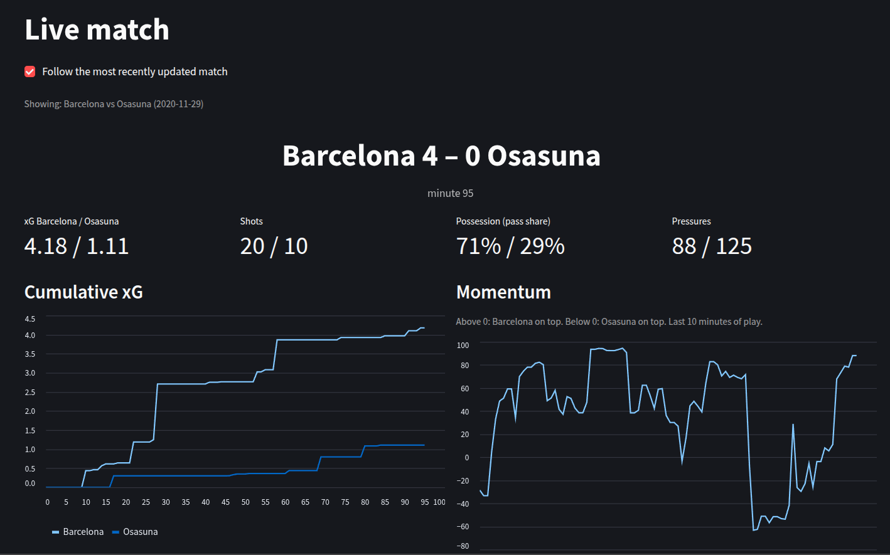
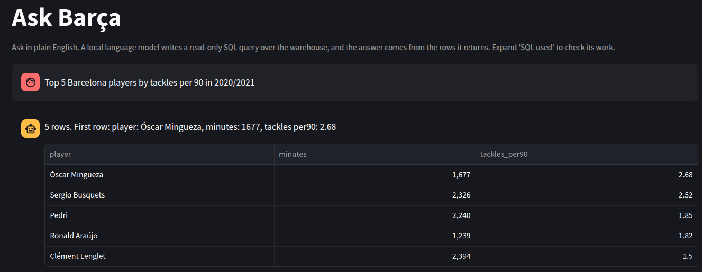
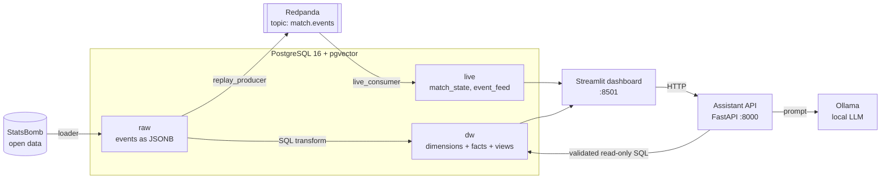

# Barça Hub

**A football analytics platform built end to end: a data warehouse, a real-time match replay pipeline, and a natural-language SQL assistant running on a local LLM.**

Barça Hub loads [StatsBomb open data](https://github.com/statsbomb/open-data) into PostgreSQL, replays matches as a live event stream through Redpanda (Kafka API), and lets you ask questions in plain English that a local model turns into safe, read-only SQL. Everything runs on a laptop with Docker, with no cloud services and no API keys.


---

## Screenshots

### Live match
A match replayed through Redpanda and rendered in near real time: score, expected goals (xG), shots, possession, pressures, and a rolling momentum indicator.



### Key events
Goals, shots, cards and substitutions, captured from the stream into a queryable feed.


### Ask Barça
Ask a question in English. A local LLM writes the SQL, the guard validates it, and the answer comes from the rows returned. The generated SQL is always available to inspect.



---

## Features

- **Data warehouse** with a star schema (dimensions and facts) and an untouched raw layer, so everything downstream can be rebuilt without re-downloading.
- **Idempotent, resumable batch ETL**: one transaction per match, an ingestion log, and safe re-runs.
- **SQL-based transformation** that derives per-player, per-match statistics (minutes played, passes, tackles, pressures, xG, xA and more) with built-in quality checks.
- **Streaming pipeline**: a replay producer publishes match events to Redpanda at an adjustable speed, and a consumer maintains a live scoreboard in PostgreSQL.
- **Live dashboard** that auto-refreshes every 2 seconds (Streamlit).
- **Text-to-SQL assistant** powered by a local model via Ollama, with layered safety: AST-level SQL guard, read-only transaction, statement timeout, row cap, and an optional read-only database role.
- **Evaluation harness** with 25 hand-written golden questions that compares query *results*, not SQL text.
- **Fully containerised** with Docker Compose profiles, so heavy components only start when you ask for them.

---

## Architecture



### Data layers

| Schema | Purpose | Contents |
|---|---|---|
| `raw` | Faithful copy of the source | Every StatsBomb event as JSONB, plus an ingestion log |
| `dw` | Clean, structured warehouse | `dim_season`, `dim_team`, `dim_match`, `dim_player`, `fact_shot`, `fact_player_match_stats`, and the semantic views `v_match`, `v_player_match`, `v_shot` |
| `live` | Real-time serving tables | `match_state` (one snapshot per match per minute) and `event_feed` (goals, shots, cards, substitutions) |

---

## Tech stack

| Area | Technology |
|---|---|
| Language | Python 3.12 |
| Database | PostgreSQL 16 (`pgvector` image) |
| Streaming | Redpanda (Kafka-compatible) and Redpanda Console |
| Dashboard | Streamlit |
| Assistant API | FastAPI, `sqlglot` for SQL validation |
| LLM runtime | Ollama (default model `qwen2.5-coder:7b`) |
| Orchestration | Docker Compose (profiles) |
| Testing | pytest |

---

## Repository structure

```
barca-hub/
├── docker-compose.yml          # all services, ports, volumes and profiles
├── .env.example                # configuration template
├── images/                     # README screenshots
├── ingestion/
│   └── statsbomb_loader.py     # extract + load: StatsBomb JSON -> raw / dim / fact_shot
├── warehouse/
│   ├── init/                   # schema DDL, runs automatically on first start (01..05)
│   └── models/
│       ├── fact_player_match_stats.sql         # transform: raw events -> player-match stats
│       ├── fact_player_match_stats_checks.sql  # data-quality checks (expect 0 rows each)
│       ├── semantic_views.sql                  # v_match, v_player_match, v_shot, search_key()
│       └── assistant_readonly_role.sql         # optional read-only DB role for the assistant
├── streaming/
│   ├── replay_producer.py      # publishes a stored match to Redpanda at your chosen speed
│   ├── live_consumer.py        # consumes events, writes live.* tables
│   ├── live_metrics.py         # pure-Python match state (score, xG, momentum), easy to test
│   ├── kafka_util.py
│   └── tests/
├── llm/
│   ├── server.py               # FastAPI: POST /ask, GET /health
│   ├── assistant.py            # question -> SQL -> guard -> execute -> answer (with retry)
│   ├── schema_context.py       # system prompt, schema description, worked examples
│   ├── guard.py                # SQL safety validation
│   ├── db.py                   # read-only, time-limited, row-capped execution
│   ├── llm_client.py           # Ollama client
│   ├── eval/                   # golden.json + run_eval.py
│   └── tests/
├── dashboard/
│   ├── app.py                  # home page
│   └── pages/                  # Live match, Ask Barça
├── api/  ml/                   # placeholders for future work
```

---

## Getting started

### Prerequisites

- Docker and Docker Compose v2
- About 10 GB of free disk space if you use the assistant (the model download is roughly 4–5 GB)
- A DBeaver (or any PostgreSQL client) installation is optional but useful for exploring the data

### 1. Configure

```bash
cp .env.example .env
```

The defaults work out of the box. Change them only if you need to.

### 2. Start the core stack

```bash
docker compose up -d
```

This starts PostgreSQL, Redpanda, Redpanda Console, the live consumer and the dashboard. The schema in `warehouse/init/` is created automatically on the first start.

### 3. Load the data (Extract and Load)

```bash
# see which seasons are available
docker compose --profile tools run --rm loader --list-seasons

# load everything available for Barcelona in La Liga
docker compose --profile tools run --rm loader --all-seasons

# or a quick test: 2020/21 season, 5 matches
docker compose --profile tools run --rm loader --season-id 90 --limit-matches 5
```

The loader is resumable and idempotent. Use `--force` to re-download matches that were already loaded.

### 4. Transform and build views

```bash
docker compose exec postgres psql -U barca -d barca_dw -v ON_ERROR_STOP=1 -f /models/fact_player_match_stats.sql
docker compose exec postgres psql -U barca -d barca_dw -f /models/fact_player_match_stats_checks.sql   # each check should return 0 rows
docker compose exec postgres psql -U barca -d barca_dw -v ON_ERROR_STOP=1 -f /models/semantic_views.sql
```

### 5. Explore the database

Connect with any PostgreSQL client:

| Setting | Value |
|---|---|
| Host | `localhost` |
| Port | `5432` |
| Database | `barca_dw` |
| User | `barca` |
| Password | `barca_dev_pw` |

```sql
SELECT player, SUM(goals) AS goals
FROM dw.v_player_match
WHERE team = 'Barcelona' AND season = '2020/2021'
GROUP BY player ORDER BY goals DESC LIMIT 5;
```

### 6. Watch a match live

Open the dashboard at <http://localhost:8501> (Live match page) and Redpanda Console at <http://localhost:8080> (topic `match.events`), then:

```bash
docker compose run --rm replay --list
docker compose run --rm replay --match-id <MATCH_ID> --speed 60
```

At `--speed 60` a full match takes about a minute and a half. Use `--speed 0` for no delay.

### 7. Ask the assistant

```bash
docker compose --profile assistant up -d
docker compose exec ollama ollama pull qwen2.5-coder:7b     # one-time download
curl -s localhost:8000/health                               # wait for database, views and llm to be ok
```

Then open **Ask Barça** in the dashboard, or call the API directly:

```bash
curl -s localhost:8000/ask -H 'Content-Type: application/json' \
  -d '{"question":"Who scored the most goals for Barcelona in 2020/2021?"}'
```

On a CPU the first answer can take a minute or more while the model loads. Later questions are faster.

---

## Services and ports

| Service | Port | Profile | Description |
|---|---|---|---|
| `postgres` | 5432 | default | Warehouse database |
| `redpanda` | 19092 | default | Kafka API for clients on the host |
| `redpanda-console` | 8080 | default | Browse topics and messages |
| `dashboard` | 8501 | default | Streamlit app |
| `live-consumer` | – | default | Always-on worker that builds the live tables |
| `loader` | – | `tools` | On-demand batch ingestion |
| `replay` | – | `tools` | On-demand match replay producer |
| `ollama` | 11434 | `assistant` | Local LLM runtime |
| `assistant` | 8000 | `assistant` | Text-to-SQL API |

## Configuration

Set in `.env` (see `.env.example`):

| Variable | Default | Description |
|---|---|---|
| `POSTGRES_USER` / `POSTGRES_PASSWORD` / `POSTGRES_DB` | `barca` / `barca_dev_pw` / `barca_dw` | Database credentials |
| `POSTGRES_PORT` | `5432` | Host port for PostgreSQL |
| `OLLAMA_MODEL` | `qwen2.5-coder:7b` | Any Ollama model; try `qwen2.5-coder:3b` on a small machine |
| `OLLAMA_NUM_CTX` | `8192` | Context window; keep it large enough for the full prompt |
| `OLLAMA_NUM_THREAD` | all cores | Cap CPU threads to keep the machine responsive |
| `PHRASE_ANSWERS` | `false` | `true` lets the model write a sentence under each table (a second, slower call) |
| `ASSISTANT_DB_USER` / `ASSISTANT_DB_PASSWORD` | `barca` | Set to `assistant_ro` credentials to use the read-only role |

---

## How it works

### Batch ETL

1. **Extract**: the loader downloads competitions, matches, events and lineups from StatsBomb's GitHub repository, with retries on network and 5xx errors.
2. **Load**: dimensions are upserted, every event is stored untouched in `raw.statsbomb_events`, and shots are flattened into `dw.fact_shot` (penalty shoot-out shots are excluded). Each match is a single transaction and is recorded in `raw.ingestion_log`.
3. **Transform** (`fact_player_match_stats.sql`): pure SQL over the raw events. It reconstructs who played and for how many minutes (starters, substitutions, red cards, extra time), counts events per player, derives expected assists (xA) by joining shots to their key passes, and finishes with a self-check that no appearance was lost.

Some metrics are deliberately simplified and documented in the SQL, for example progressive passes and carries (a move must end at x ≥ 48 and gain at least 10 yards toward goal) and possession (share of passes, not time on the ball).

### Streaming pipeline

```
raw.statsbomb_events ──► replay_producer ──► Redpanda (match.events) ──► live_consumer ──► live.match_state
                                                                                      └──► live.event_feed
```

- The producer reads a stored match, stitches the periods into one continuous clock, and publishes small JSON messages (wrapped in `start` and `end` markers) at `real time ÷ speed`. The topic has a single partition to guarantee ordering.
- The consumer keeps a running state per match: score, shots, xG, pass-share possession, pressures, and **momentum**. Momentum is computed over a sliding 10-minute window where a shot is worth 10 × its xG and a completed pass or carry in the attacking third is worth 0.1; the result is scaled to −100 … +100.
- Writes are upserts and every replay begins by clearing that match's rows, so replaying the same match never double counts.
- The "live" feed is a replay of stored data. Only `replay_producer.py` would need replacing to consume a real feed.

### Ask Barça: text-to-SQL with guardrails

```
question → prompt → LLM writes SQL → guard → read-only execution → table + "SQL used"
                         ▲                                              │
                         └──────── retry once on error / empty result ◄─┘
```

1. **Prompt**: strict rules, a description of the three semantic views and their allowed values, and worked examples. The model returns only SQL, or `CANNOT_ANSWER: <reason>` for out-of-scope questions (transfers, predictions, and so on).
2. **Guard** (`guard.py`): the SQL is parsed with `sqlglot` and accepted only if it is a single `SELECT` over whitelisted `dw` tables. Writes, DDL and dangerous functions are rejected.
3. **Execution** (`db.py`): read-only transaction, 8-second statement timeout, 200-row cap. An optional `assistant_ro` database role adds a final layer of protection.
4. **Answer**: by default a plain sentence built from the returned rows (no second model call, so nothing can be invented). The generated SQL is always shown.

---

## Testing and evaluation

```bash
# assistant tests (guard, pipeline, server, views, examples); DB-backed tests skip if the database is unreachable
cd llm && pip install -r requirements-dev.txt && pytest

# streaming tests (pure-Python live metrics)
cd streaming && pip install -r requirements-dev.txt && pytest
```

**Evaluation.** `llm/eval/golden.json` contains 25 questions (easy, medium, hard, refusal and hostile cases), each with a hand-written reference query. The runner executes both queries and compares the results.

```bash
docker compose --profile assistant run --rm assistant python eval/run_eval.py
docker compose --profile assistant run --rm assistant python eval/run_eval.py --levels easy,medium
docker compose --profile assistant run --rm assistant python eval/run_eval.py --dry-run     # no model: checks the harness and views
```

---

## Using another team

The loader accepts `--team` and `--competition-id`, and the transform, replay, live consumer and live dashboard work for any loaded match. A few places are Barcelona-specific and need editing for another club: the Barcelona point-of-view columns in `v_match`, the prompt and examples in `llm/schema_context.py`, the coverage text in `llm/assistant.py`, the golden questions, and the Ask page. Also check how much data StatsBomb publishes for the club you want; coverage varies a lot.

---

## Limitations

- Data is limited to what StatsBomb publishes as open data.
- The live match is a replay of stored data, not a real-time feed.
- Some metrics are simplified (progressive actions, possession, momentum) and are not the providers' official definitions.
- A 7B model on a CPU is slow and can still write incorrect SQL. Always check the "SQL used" panel.
- Default credentials and published ports are intended for local development only.
- `api/`, `ml/`, and the tables `dim_player_contract`, `fact_player_season_stats` and `player_embedding` are placeholders and not populated yet.

## Roadmap ideas

- A single `FOCUS_TEAM` setting to switch clubs without editing code
- Season-level aggregates in `fact_player_season_stats`
- Player similarity search with embeddings (`pgvector` is already installed)
- A real-time data source replacing the replay producer

---

## Data attribution

Match data is provided by [StatsBomb](https://statsbomb.com) under their open data terms. See the [StatsBomb open-data repository](https://github.com/statsbomb/open-data) for the licence and attribution requirements, and credit StatsBomb in anything you publish using this data.

## License

No license has been specified for this repository yet. Add a `LICENSE` file before sharing it publicly.
